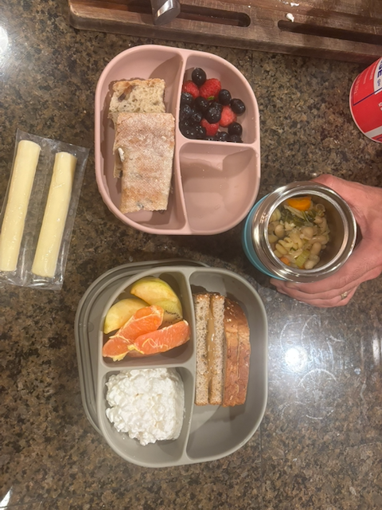

:::{#hero-heading}
## Hello! Thank you for watching Wendell Moon! Please check out these instructions and resources, they're excessive.

## Important phone numbers
| | | 
|:---|:---:|
|**Pediatrician (Sellwood Medical)** | 503-595-9300 |
|**Oregon Poison Control** | 800-222-1222 |
|**Maddog** | 208-891-5431 |
|**Gman** | 208-651-1748 |
|**Sweet Day Director (Rita)** | 971-339-3715 |
:::

## Getting in

Welcome to our home! 

The code to the front door and garage are the same: **0824**.

## Daily Schedule

Big W is a freeform child and defies predictability. This is, at best, an estimate for what a typical day is like. Now that I write it down, it's likely to drastically change, as he'd hate to let us think we know what he'll do. Also, we've mostly adopted the same schedule as day care, so he really is expecting snacks and naps and transitions at these times with eerie precision.

- **6:30-7:00 am** -- Wake up! Will almost certainly demand you read his current book obsession
- **7:30 am** -- Breakfast. Usually, he's content with a toaster waffle or peanut butter toast or cottage cheese.
- **7:45 am** -- Head to school / leave the house
- **9:15 am** -- Morning snack
- **12:15 pm** -- Nap time! Outside of school, naps have been a little hit or miss... Sometimes he'll sleep for almost 2 hours, other times you'll work very hard to convince him to sleep for even 15 minutes... See [Sleep Routines Section @sec-sleeproutine] below for tips.
- **2:00 pm** -- If you're lucky, he may have slept this long!
- **3:00 pm** -- Afternoon snack
- **4:30 - 5:30pm** -- Somehow his most ravenous window, can eat a shocking amount here. Always bring food to school pickup!
- **4:45 - 5:00 pm** -- School pickup! We get charged by the minute after 5, so it'd be great to leave some buffer time as traffic can get shockingly bad...
- **6:00 pm** -- Despite all you may think you just fed him, he gets hungry for real dinner around here! After dinner he resumes his tyrannical assertions to "READIT".
- **7:30 pm** -- Bath time. We don't do this every night, really just an as-needed situation -- we leave it up to you to determine frequency. 
- **7:45 pm** -- Get ready for bed! See below for sleep routine, it typically takes right about 15 minutes to wrangle him.
- **8:00 pm** -- Wendell's circadian rhythm is at least as precise as a the fine Swiss clock, and Wendell is calibrated to become immensely ready for bed at exactly 8pm.  If the sleep routine is still ongoing, we recommend that you just chuck him in his bed at whatever point you're at.

## Leaving the House (School Day)

**See [School Food Section @sec-schoolfood] below for school food requirements!** We typically pack his lunch the night before to help get out the door.

- [ ] Lunch
- [ ] Lunch cooler & cold pack
- [ ] Water bottle (usually the white metal bottle with doggies riding bikes)
- [ ] Jacket
- [ ] Shoes/boots (I usually let him choose)
- [ ] Sun screen
- [ ] Snack for the road (regardless of his having already eaten breakfast, it's crazy)

It's unlikely this will come up, but sometimes school will let us know that Wendell is low on diapers. In this case, we bring a full sleeve of diapers the next day. These can be found in the closet in Wendell's room.

### School Drop Off

**School address: 3777 SE Milkaukie Ave**

There is a parking lot around the back of the school! Note that it's quite tight in there, so if there are street spots, it's actually easier to use these.

Wendell is in Room 2 these days (very visible as you walk in the front door). When you drop him off, there will be a sign in sheet just inside  Room 2 (on top of the cubbies to the right). He should know to take his shoes off and put them on the shoe rack, but will probably need reminding/assistance to wash his hands. His lunch and water go on a rack next to the bathroom area. His coat goes on the hooks above his shoes.

Wendell is usually extremely keen on jumping straight in to whatever the morning activity is, so do not be expected if he barely notices you leaving. Rarely though, he may decide that he doesn't want to be at school and get sad :( In these cases, it's actually best to make a swift departure becaue he's much more likely to only get more sad the longer you hang out.

### School Pickup

Most days the kids will be out back in the play area behind the school (just next to the parking lot). Wendell has an extreme pavlovian response to our arrival -- he is very likely to be ravenously hungry when you arrive, so it's best to have a snack ready to go. If there are still tomatoes on the bushes in the raised garden bed, he's also likely to ask for a few (I think most are pretty mushy right now though...).

The sign in/out sheet will be on a table just inside the gate between the parking lot and the play area. Wendell's water bottle will likely there too, but sometimes it's been cast asunder among all the toys on the turf. From there, I usually grab him and then go inside to get his jacket and lunch (and sometimes a baggy of dirty clothes if he needed an outfit change) -- the teachers can let you in the back way, where you can probably navigate yourself to Room 2 in the front of the building.

## Leaving the House (Non-School Day)

Here's my handy-dandy checklist, tick things off as you go (we'll set you up with an embarassing Ironman bag):

- [ ] Big embarrassing ironman bag (or if that's too too embarassing, any other bag you please)
- [ ] Fanny pack diaper bag -- filled with diapers & wipes
- [ ] 2-3 Small toys (harmonica, toy car, music book)
- [ ] Snacks (baby bell cheeses, string cheese, cottage cheese, apples)
- [ ] Change of clothes

Wendell, much like his mother, requires extensive physical exercise for his own sanity. It is highly advisable to get out of the house for some kind of adventure shortly after breakfast, or he'll turn the house inside out.

Fun destinations include: [Woostock Park](https://maps.app.goo.gl/WtRxSKf8MpZ4k6kq7), [Creston Park](https://maps.app.goo.gl/qXiksNdsTUFWwPuG9), [OMSI](https://maps.app.goo.gl/33CAnNRuFRukaPk97), [the zoo](https://maps.app.goo.gl/SSTrr1pgQevzFXNZ8), or honestly anywhere he can run around.

## Food

### Non-School Day

He's really not picky, he'll truly almost anything you put in front of him. Exceptions are salads/greens and veggies like bell peppers. We haven't convinced him those are food yet... 

We recommend packing some Baby Bell cheeses or string cheese as snack supplements and/or backups if he eats way more than you expect.

### School Day {#sec-schoolfood}

School has some requirements for meals:

- There must be the makings of 2 snacks and a lunch. We only have two snack tray container things, so we just fill all four compartments with a variety of things. Both containers must contain: a protein, a vegetable, and a carb.
- Also, there are several varieties of nut allergy present in the school, so **all nuts and sesame seeds are banned** -- so no hummus (quite unfortunate, as that was one of our staples for a long time...)

For snack(s), I typically pack either yogurt or cottage cheese, some kind of fruit (berries, apple slices, quartered grapes), and a sun flower butter sandwich (one slice of bread folded over in the big compartment). 

For lunch, I typically pack some dinner leftovers in the large compartment, some kind of bread or carb thing in one of the small compartments (cous cous, naan, muffin, a piece of pie if you're feeling spicy) and either a fruit or a veggie in the other small compartment. 

And as a backup, I always throw in one or two Baby Bells or cheese sticks. Most of the time, these will come back home with him; other times, he'll refuse something you were certain he'd love...

## Sleep Routine {#sec-sleeproutine}

### Naptime

These have been somewhat tough for us recently... It might take some cajoling to get him in his sleep sack and to settle enough to read a book. Then you'll have to put him in bed against his wishes.

If the stars have aligned, he may go to straight to sleep when you put him in -- other times he needs to cry for a few minutes (notably while lying down in his sleeping position). If he seems really mad and/or is standing up and crying, it can take a while to peter out... 

If it's been a truly long time (> 30 minutes) or if he seems truly, truly sad, we've resorted to putting him in the car or the bike trailer for a 30-60 minute power nap.

### Nighttime 

- Brush teeth at 7:45 pm
  - Wendell will expect to have a turn brushing. We typically sing *Twinkle Twinkle Little Star* for his turn and then again when it's our turn.
- Change diaper and wrestle him into a clean shirt (and pants if it's noticeably cold)
- Again wrestle him into his sleep sack (he'll almost certainly escape after the shirt like a giggling buffoon)
- Read a book. Nighttime favorites cycle, but big hits are *I Spy Wendell*, *Just Me and My Mom*, *Just Camping Out*, and *I Love Wendell This Much*
- At 7:59 pm, you should declare it's time for night night, and he'll almost certainly slump over and assume his sleeping position.
- You'll then be able to lug him into his bed.
- Before you zip his tent up, he'll pop back up and demand some water. Hence the water bottle there by his bed.

Most nights these days, he sleeps straight through to the morning! But, if he does start crying in the night, you should check the video monitor before going to check on him -- he seems to sometimes have intense dreams  and will have a half-hearted cry in his sleep before settling back down. 

If he sounds actually sad or stands up, he'll probably want to talk about the dream he had. He has a bizarrely coherent memory from like 6 months ago when a very loud choo choo train surprised him while we were berry picking. If he starts talking about it, it seems to help him settle back down by running through the whole story and reminding him that everyone was ok after the choo choo train left and telling him that it's time for bed. Maybe offer him some water and sing a song if you can't break him out of his story telling cycle.

## Car Seat -- Graco Extend2Fit

**The instructions manual is stored in the little slot underneath the seat! Check here if anything feels off.**

:::{.border}

<iframe width="560" height="315" src="https://www.youtube.com/embed/jvaOuE-8lmI?si=CLltRk5fg-hirc_4" title="YouTube video player" frameborder="0" allow="accelerometer; autoplay; clipboard-write; encrypted-media; gyroscope; picture-in-picture; web-share" referrerpolicy="strict-origin-when-cross-origin" allowfullscreen></iframe>

I thought about writing a thing about how to use the car seat and then I realized it would be so much easier to just link to a video. So here it is -- hopefully it works... Check this out if we forgot to show you how to use the car seat or if you want a reminder!
:::

## Non-Wendell Notes

- The WiFi password is on the fridge.
- The door code to get into school is also on the fridge.
- Trash day is Monday, so we typically put the cans out on Sunday night. 
  - Extra trash bags are under the sink, behind the recycling box.
- Our furnace isn't working!! Please do not turn on the main heat from the thermostat, the HVAC guy told us it isn't safe to use. (A new one is scheduled to be installed in November...).
  - If it's wildly cold in the morning, please feel free to turn on the fireplace downstairs. It's surprisingly effective at heating the house -- which is a good reason make sure to turn it off once it's warm enough downstairs.
- The dryer auto settings do not work, we usually just do a timed run.